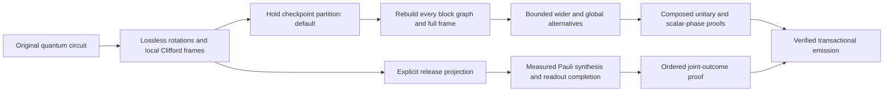
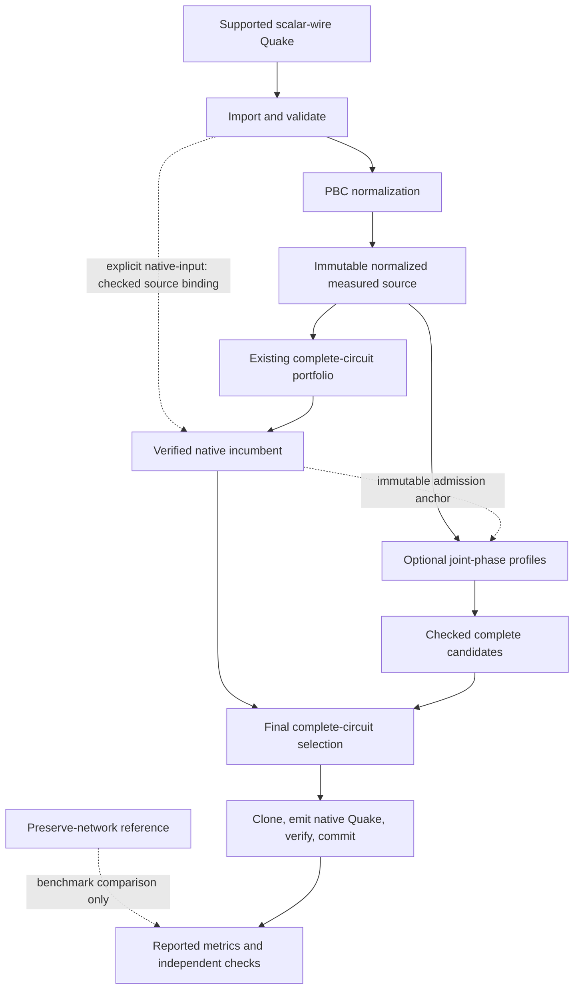
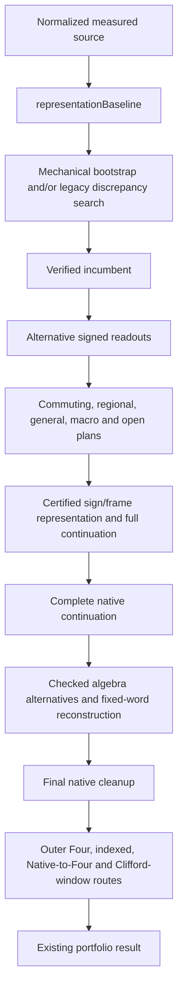
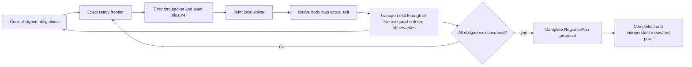
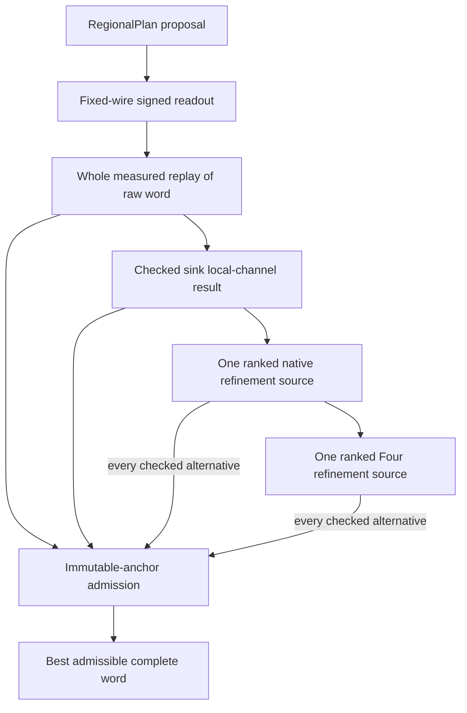
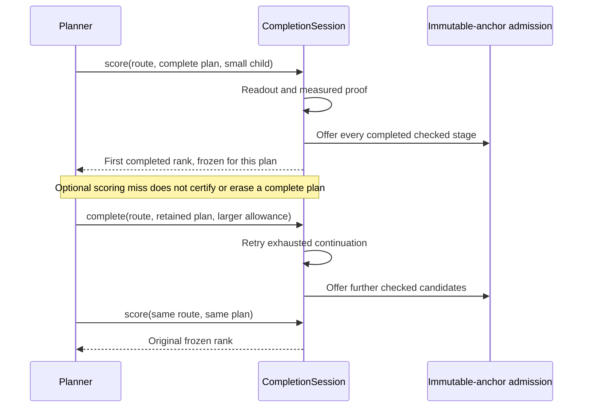
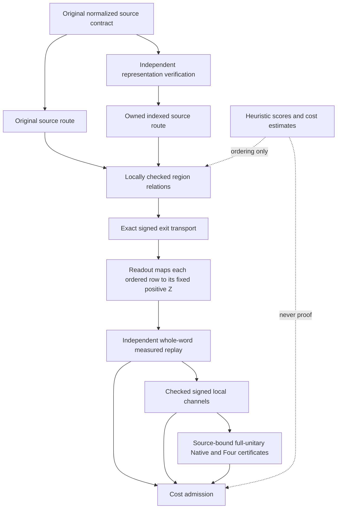
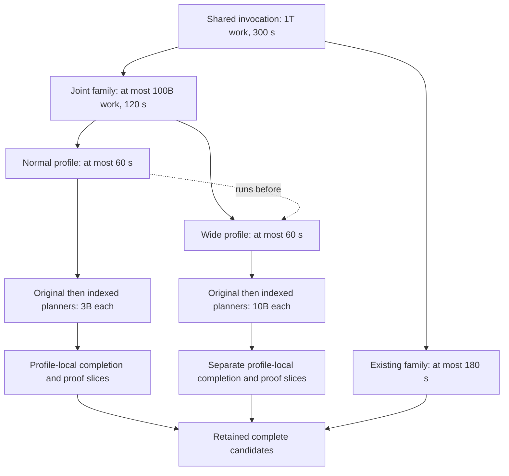

# PBC synthesis architecture

## Hold and release synthesis contracts

The synthesis interface defaults to the explicit `hold` contract,
which preserves the complete unitary of a quantum region, including scalar
phase and physical wire identities. This is network-changing Pauli synthesis:
the original Clifford network is not a constraint on the synthesized network.
The existing terminal-measurement implementation remains the `release` route.

Hold conversion retains local Clifford/phase frames between Pauli rotations.
It does not absorb the entire circuit into one frame before synthesis: that
spreads local arithmetic into wide axes and creates expensive reconstruction
debt. Each synthesized block has a lossless rotation word and an actual
Clifford/phase witness, with `U = F * R`. A synthesized rotation body can have
an actual Clifford exit `E`, satisfying `body = E * R`. Hold completion
synthesizes `F * inverse(E)` and appends it to the body. Release completion
instead reconstructs the transported terminal observables. A measured proof
cannot certify a hold result.

`pbc::normalizeUnitary` returns `UnitaryForm { rotations, frame, error }`.
The frame is an actual primitive-Clifford/phase witness. Exact Clifford-angle
rotations remain in the Pauli word, matching the independent replay's supported
normalization. The frame supplies the action to reconstruct; its gate network is not a
search incumbent. The default `graph::synthesizeUnitary` portfolio in
[SynthesisHold.h](../cudaq/lib/Optimizer/Transforms/Pauli/SynthesisHold.h) first
partitions the source into blocks of at most three active wires and 64 imported
operations. An individually wider operation remains intact. Every block is
compacted onto its active wires, independently normalized and bound to its
actual source, and has both its rotation graph and full Clifford frame rebuilt.
The same injective wire map embeds source and result into the original physical
interface, so local unitary proofs compose for arbitrary entangled inputs and
retain scalar phase. No original or preserved-network optimized circuit is an
incumbent. Native refinement consumes only generated, verified circuits.

After this complete route, a four-wire route has a separate 10B-work/30-second
slice, followed by a global route with a 1B-work/5-second slice. Parent work and
deadlines remain authoritative. Optional exhaustion retains the completed
incumbent; an invalid proof or certificate binding is fatal even if a verified
incumbent exists. Route diagnostics distinguish these outcomes. Blocks use
graph/frame reconstruction and phase-exact native continuations. The optional
global route additionally explores the enabled regional, general/macro,
open-region, and joint-phase routes. Quantum-boundary plans retain
`RegionalPlan::exitCliffords`; the joint
planner transfers its already accumulated actual exit into the published plan.
Whole-program completion synthesizes the inverse exit followed by the source
frame and independently checks the resulting full unitary against that source.
Completion and final admission include the tail's native cost. Native and
Clifford-window continuations compose their source-bound, phase-sensitive
certificates with this proof.

The generic planning view marks quantum-boundary requests explicitly; the
measured candidate sink rejects those requests. No fictitious measurements are
introduced to represent a quantum output. Release plans retain their original
observable/readout interfaces and leave the extra exit vector empty. Their
search order, measured proof, and admission policy are unchanged.

`quake-to-pbc`, `quake-synthesize-pbc`, `quake-optimize-pbc`, and
`quake-try-pbc` expose `semantics=hold|release`, defaulting to `hold`.
Normalization records `quake.pbc_semantics` on the function. Hold retains local
Clifford frames and scalar phases as real Quake operations, rather than opaque
metadata. It preserves the original terminal measurement operations and their
post-measurement basis, and reconnects scalar quantum return operands as well
as sinks. `quake-verify-pbc` and `quake-lower-pbc` honor the recorded contract.
Marked release input is rejected by a hold request: its missing original frame
cannot be recovered by changing a synthesis option. Regenerate it from the
original pre-normalization circuit. An unmarked input is interpreted as the
actual supplied circuit, without claiming recovery of earlier discarded data.

The Quake boundary accounts for `T = exp(i*pi/8) Rz(pi/4)` and the compensating
phase when a rotation is emitted as named Z/S/T gates. Exact scalar phases use
`quake.phase` with checked rational metadata and a matching constant operand;
opaque scalar angles retain their SSA identity. Consequently hold is suitable
for later adjoint/control specialization. Scalar SSA quantum returns are
supported; borrowed wire sets, reference inputs, control flow and quantum
feed-forward remain outside this importer.

Readout alternatives and signed-observable representation searches are
release-only providers; their tuning controls do not enable them for hold.
`synthesis-prune-unobserved=true` and `assume-measure-all=true` require release.
The regional readout beam and the joint planner's partial readout-context scorer
also remain release-specific. Hold uses exit-carrying regional sweeps and full
Clifford completion when scoring complete joint plans. Its search remains
bounded and heuristic; there is no promise that a cheap prefix has a cheap tail.
Hold ranks complete proposals by the configured objective with a T-nonincreasing
guard against its verified incumbent. The release portfolio's joint acceptance
and legacy scheduling policies remain release-specific. Exact native
hold continuations rank source-bound generated words by the requested objective
with nonincreasing T count, allowing explicitly visible secondary-metric
tradeoffs. Release continuations retain their existing five-metric guards. No cost or
acceptance option relaxes the selected semantic proof.

Hold native refinement also checks a bounded three-wire four-T identity that
reconstructs a 14-gate generated gadget in 12 gates, retaining four T rotations.
The established native portfolio runs first. The extra candidate starts from
the same generated source, preserves intervening scalar phases, and is admitted
only when its full-circuit objective improves without increasing the retained
incumbent's T count. Each match is compacted onto its actual three physical
wires and independently replayed including scalar phase. A 32-operation match
window, a 262,144-operation entry bound and the shared work/deadline budget
bound this optional stage. Exhaustion retains completed candidates. The
T-only decoder's strict T-reduction policy is unchanged.

The remaining portfolio description below documents the release route. Hold
measurements and release regression comparisons are recorded separately in
[the synthesis tuning report](pbc_synthesis_tuning.md).

Hold Quake accepts explicit primitive Clifford/phase operations as well as
Pauli rotations. Hold conversion preserves local frame boundaries;
`quake-to-pbc='local-frames=false'` instead requests global absorption for
controlled comparisons. `synthesis-hold-checkpoints=false` selects the global
hold synthesis route. These hold-only choices do not change release behavior.
Within each block, normalization establishes the rotation-word/frame split;
completed native networks may interleave their gates. The verifier checks the
actual operations, SSA ownership, supported measurements, and quantum exits;
the semantics attribute alone never proves equivalence.

The initial hold implementation passed 366 native tests and all 14 PBC lit tests. Added
checks compare full complex matrices including phase, signed and exact
Clifford-angle rotations, carried regional/joint exits, native entangler
profiles, scalar wire returns, original live measurement instruments, default
hold optimization, exhausted proof budgets and rejected release-to-hold
promotion. Existing release tests explicitly request release. Independent
before/after release benchmark checks are reported with the hold measurements.
The initial fifteen-key-case hold run emitted fourteen independently verified circuits;
adder433 reached its 120-second synthesis limit. Adder4, QFT-2 and mod5_4 have
identical independently verified release outputs before and after this change.

The integrated checkpoint implementation passes **380 native tests and all
15 PBC lit tests**, including sparse physical-wire embedding, a Pauli operation
wider than a checkpoint, scalar-only identity rotations, optional exhaustion
and fatal invalid proofs after an incumbent exists. Conversion tests show that
local frame retention avoids widening a one-wire rotation into a four-wire
axis, and independently compare the full complex unitary including phase.
The final fifteen-case checkpoint measurements and exact profile are recorded
in [the tuning report](pbc_synthesis_tuning.md#integrated-hold-checkpoints-fifteen-case-validation-2026-11-06).

## Scope and implementation model

The release implementation reconstructs a native circuit from normalized Pauli-based computation (PBC): an ordered rotation word, signed terminal observables, and fixed physical readout wires. Its terminal contract preserves the **ordered joint measurement distribution for arbitrary input states**, including states entangled with an external reference. It does not preserve the post-measurement quantum state.

The top-level architecture is a **portfolio of complete-circuit routes**. An existing synthesis and optimization pipeline first produces a verified native incumbent. An optional joint-phase family then constructs additional complete programs from the normalized source. Each family contains bounded regional planners, but there is no single planner choosing freely among all strategies at each region. Candidate generation, proof, completion, and final selection are separate responsibilities.

The normalized-input entry point reconstructs that incumbent from the Pauli
source. It cannot recover the circuit that existed before normalization. The
historical quality gap is recorded in
[the optimization report, F.5](pbc-optimization-report.md#f5-suite-capacity-investigation-2026-11-06).
The explicit `semantics=release native-input=true` entry point now imports the
primitive native source, normalizes it privately and checks the source binding
before using the incoming circuit as an immutable incumbent. The default
`native-acceptance=all-metrics` admits a synthesis result only when none of the
five native metrics increases and the configured rank strictly improves.
`native-acceptance=gates-and-t` permits reported secondary-metric tradeoffs.
Expected search limits retain the incoming circuit; a proof mismatch fails the
pass. This mode does not invoke the preserve-network optimizer. It is separate
from default `semantics=hold`.

Joint planning and completion now use the configured global source gate cap,
without an additional 32,768-rotation cutoff. Dependency admission bounds the
compressed occurrences, axis classes and stored class conflicts before
allocation, independently of the logical dependency limit. Local packet,
scratch, work and deadline limits still apply; enabling a route does not imply
that it completed a candidate.

The main entry point is `graph::synthesizeMeasured` in [GraphSynthesis.cpp](../cudaq/lib/Optimizer/Transforms/Pauli/GraphSynthesis.cpp), with public controls in [GraphSynthesis.h](../cudaq/include/cudaq/Optimizer/Pauli/GraphSynthesis.h). The implementation and configuration described here are the integrated architecture used for the fixed-configuration reconciliation. Benchmark results and their current validation status belong in [the synthesis report](pbc_synthesis_tuning.md), rather than being duplicated in this document.

The preserve-network reference is a separate optimization path and comparison
target. Normalized-PBC providers do not use it. The explicit native-input mode
retains the unoptimized incoming circuit as a checked quality floor; generated
native words may undergo their usual synthesis continuations.

## 1. IR boundary and semantic contracts

### Quake ingress and transactional emission

[PBCPasses.cpp](../cudaq/lib/Optimizer/Transforms/PBCPasses.cpp) implements the importer, `Plan`, `read`, `emit`, and the pass drivers. The pass declarations and command-line names are in [Passes.td](../cudaq/include/cudaq/Optimizer/Transforms/Passes.td).

| Pass or entry point | Responsibility |
|---|---|
| `quake-verify-pbc` / `QuakeVerifyPBCPass` | Validate the actual IR contract; an attribute or marker is not proof. |
| `quake-to-pbc` / `QuakeToPBCPass` | Import supported primitive circuits and absorb their Clifford frame into rotations and terminal observables. |
| `pbc::normalize` | Native-library normalization, preserving ordered terminal measurement probabilities. |
| `quake-synthesize-pbc` / `QuakeSynthesizePBCPass` | Read already normalized PBC, call `graph::synthesizeMeasured`, and emit a verified native completion transactionally. |
| `quake-lower-pbc` / `QuakeLowerPBCPass` | Mechanical basis/parity and joint-readout lowering without the synthesis portfolio. |
| `quake-optimize-pbc`, `quake-try-pbc` / `PBCOptimizationPass` | Separate optimization/round-trip drivers, including the optional preserve-network output path. |

Verified PBC uses a single block, distinct scalar SSA wires, static Pauli words, uncontrolled arbitrary-angle `quake.exp_pauli` rotations followed by terminal commuting `quake.mpp` operations, and explicit sink closure. The importer rejects escaping quantum outputs, borrowed wire sets, control flow, and classical feed-forward into quantum operations. Supported classical operations, measurement discrimination, and classical returns remain connected to their original outcomes.

`QuakeSynthesizePBCPass` builds a shared `SearchBudget`, passes measurement readout identities explicitly, and consumes the synthesis result only on success. It clones the function, emits the candidate, runs MLIR verification, and commits the clone. Search never incrementally mutates the original function. The pass records synthesis work and outer-budget exhaustion as attributes; these are telemetry, not correctness certificates.

### Native Pauli representation

[Circuit.h](../cudaq/include/cudaq/Optimizer/Pauli/Circuit.h) defines `QubitSet`, `Pauli`, `Angle`, `Gate`, and `Kind`. `QubitSet` uses dynamically sized storage; a 64-bit machine word is not a circuit-width limit. A Pauli stores X and Z support plus its sign. A rotation represents

\[
R_P(\theta)=\exp(-i\theta P/2).
\]

Rational angles are exact multiples of π. Opaque angle identities remain symbolic and are not approximated into Clifford+T sequences. Explicit scalar phases matter to full-unitary subproofs even though a global phase is unobservable at the final measured boundary.

[PBC.h](../cudaq/include/cudaq/Optimizer/Pauli/PBC.h) and [PBC.cpp](../cudaq/lib/Optimizer/Transforms/Pauli/PBC.cpp) implement `pbc::normalize` and `CommutingObservables`. Normalization absorbs Clifford operations into the signed axes and ordered terminal observables. It does not assume an all-zero initial state.

### Three different contracts

| Contract | What must be preserved | Main representation |
|---|---|---|
| Closed quantum region | Entire unitary, including scalar phase where required by the checker | Native gate word; `graph::equivalent` and checked backend witnesses |
| Open quantum region | Exact relation between body, source region, and an actual Clifford exit | `JointPhaseImplementation`, commuting/open-region implementations |
| Complete measured program | Ordered joint outcome probabilities for arbitrary inputs, with fixed physical readout identities | `MeasuredProblem`, `MeasuredCandidateSink`, `CertifiedCompletion` |

The measured contract cannot be substituted for an internal live quantum region. An internal region must account for its actual exit on every later quantum obligation. Conversely, the terminal measured contract intentionally permits changing an unobserved final quantum state.

## 2. Shared contracts, costs, and dependency structure

### Measured problems and checked candidates

[SynthesisCandidates.h](../cudaq/lib/Optimizer/Transforms/Pauli/SynthesisCandidates.h) defines:

- `MeasuredProblem`: a borrowed immutable view of width, ordered rotations, signed observables, and physical readout wires.
- `MeasuredCandidateSink`: independent whole-word measured replay followed by checked local signed-frame refinement and the existing selection policy.
- `VerifiedCandidate`: a privately constructed value indicating measured replay, optionally composed with checked local channels.

The sink's implementation is in [GraphSynthesis.cpp](../cudaq/lib/Optimizer/Transforms/Pauli/GraphSynthesis.cpp). `submit` checks native basis, operands, size, measured equivalence, and the source T-count guard. `takeBest` retains the existing five-metric comparison against the best unrefined rollout. A proof enum is descriptive; it is not permission to reuse the candidate against another source.

`RegionalPlan`, in [SynthesisRegions.h](../cudaq/lib/Optimizer/Transforms/Pauli/SynthesisRegions.h), contains a native prefix and residual signed observables. It is a **proposal**, not a complete native circuit or transferable proof. A caller must construct the fixed-wire readout and verify the resulting whole program.

### Native cost and ranking

[SynthesisCost.h](../cudaq/lib/Optimizer/Transforms/Pauli/SynthesisCost.h) centralizes `nativeWord`, `evaluateNativeCost`, `evaluateCircuitCost`, `CostVector`, and `circuitScore`.

The five reported integral metrics are total gates, T count, two-qubit gates, depth, and T-depth. Native weights can distinguish CX, CZ, SWAP, one-qubit Clifford, and T costs. `nativeWord` materializes the selected entangling profile before final comparisons. For the total-gates objective, the common rank is weighted native cost, T count, depth, two-qubit count, then T-depth. With unit weights, the first component coincides with the supported native gate-count model.

Opaque rotations use the existing unresolved-rotation proxy for ranking; their eventual approximation cost is not known here. Cost evaluation does not prove equivalence, and a low prefix cost does not bound the cost of its terminal readout.

### Exact dependency index

[SynthesisDependencies.h](../cudaq/lib/Optimizer/Transforms/Pauli/SynthesisDependencies.h) provides `DependencyIndex::build` and `DependencyCursor::{create,ready,consume}`. It groups repeated unsigned Pauli axes into classes and stores conflicts between classes. Occurrence order still determines the exact readiness constraints. Ignoring signs for commutation does not remove signs from the quantum program.

The logical dependency cap retains the meaning of the original occurrence graph: the number of earlier/later anticommuting occurrence pairs. Compression changes storage, not which edges are enforced. If there are `m` occurrences, `K` distinct axes, and `A` stored class conflicts, storage is proportional to `m + K + A`; conflict discovery uses O(K²) Pauli comparisons. The index does not silently discard constraints to fit a cap.

`synthesis-dependency-bytes` defaults to 536,870,912 bytes. The index checks a
conservative storage bound before each allocation and reports its accounted
bytes separately from logical edges. The joint planner additionally fits that
index inside its 128 MiB phase envelope with its other live storage. A logical
edge allowance is no longer charged as though every occurrence edge were
stored. Exhaustion publishes no partial index and leaves checked incumbents
available.

A common Clifford conjugation preserves all pairwise commutation relations, so the joint planner can reuse the original dependency index while carrying exits. Rewrites that change the underlying obligation word require the appropriate reconstruction or a new index. The legacy `Synthesizer::run` also preserves its established occurrence traversal and newly unblocked-node behavior.

## 3. Existing complete-circuit portfolio

The existing family remains an independently useful pipeline. Its orchestration is in `runMeasuredPortfolio` and `synthesizeMeasured` in [GraphSynthesis.cpp](../cudaq/lib/Optimizer/Transforms/Pauli/GraphSynthesis.cpp). Optional providers are gated by their public controls and remaining budget.

The diagram shows orchestration, not a requirement that every stage run. Resource limits can stop optional exploration after an earlier verified result exists.

### Feasibility and primitive reconstruction

`representationBaseline` selects the baseline schedule. With `legacyWorkLimit == 0`, it retains legacy-first behavior. A positive limit first attempts a checked mechanical completion, then bounds legacy search in a child slice so other providers retain resources.

[SynthesisBootstrap.h](../cudaq/lib/Optimizer/Transforms/Pauli/SynthesisBootstrap.h),
`buildBootstrapPrefix`, lowers normalized rotations while sharing compatible
basis/parity prefixes between neighboring gadgets. It emits the inverse of
the previous unmatched suffix and the next unmatched suffix, then restores the
final Clifford frame. Signed axes, opaque angles and scalar phases retain
their exact meanings. Two streaming traversals count the actual shared output
before reserving its vector; scratch is proportional to circuit width. The
diagnostics also report the independent-gadget size for comparison. The caller
still supplies and proves readout. Native-input mode bounds this mechanical
attempt by the incoming word size without reducing the established caps of
later search and cleanup routes.

`runMeasuredSearch` and the private `Synthesizer` explore primitive Clifford actions, ready Pauli obligations, frame costs, and bounded discrepancy rollouts. Candidate scoring can include emitted action cost, sampled residual support, ready-frontier weight, readout cost, and ASAP scheduling credit. These are heuristics. Completed circuits go through measured replay and the sink.

### Readout and regional routes

| Component | Role and proof boundary |
|---|---|
| [SynthesisReadout.h](../cudaq/lib/Optimizer/Transforms/Pauli/SynthesisReadout.h), `generateReadoutCandidates` | Alternative elimination orders and pivots for signed terminal observables. Each complete native tail independently maps every original row to positive Z on its specified physical wire. Output identities are never permuted to improve cost. |
| [SynthesisCommuting.h](../cudaq/lib/Optimizer/Transforms/Pauli/SynthesisCommuting.h), `solveCommutingRegion` | Bounded implementations of commuting regions, including small-rank alternatives and actual Clifford exits. |
| [SynthesisRegions.h](../cudaq/lib/Optimizer/Transforms/Pauli/SynthesisRegions.h), `generateRegionCandidates` | Completed commuting sweeps, then bounded alternatives over different carried boundaries. |
| [SynthesisGeneral.h](../cudaq/lib/Optimizer/Transforms/Pauli/SynthesisGeneral.h), `generateGeneralCandidates` | Compact adjacent-window reconstruction with a full-unitary synthesis baseline. |
| [SynthesisMacros.h](../cudaq/lib/Optimizer/Transforms/Pauli/SynthesisMacros.h), `solveMacroRegion` | Bounded multi-action body/exit proposals. The `SynthesisGeneral` adapter closes and independently verifies selected candidates; the standalone macro proposal is not a certificate. |
| [SynthesisOpen.h](../cudaq/lib/Optimizer/Transforms/Pauli/SynthesisOpen.h), `generateOpenRegionCandidates` | Open-region synthesis and exact propagation of actual exits through subsequent rotations and observables. |

`tryRegionalAlternatives` first attempts the small whole-word commuting case, then completed regional sweeps, a boundary beam, general reconstruction without and with macros, and open-region plans. `tryCompletedRegion` finishes each plan with readout and the measured sink. This is a portfolio of completed proposals, not unrestricted mixing of these implementations in one global search.

### Representation changes and algebraic alternatives

[SynthesisRepresentations.h](../cudaq/lib/Optimizer/Transforms/Pauli/SynthesisRepresentations.h) defines `RepresentationAlternative`, `FlipTSign`, `exploreRepresentations`, and `verifyRepresentation`. A sign/frame change is allowed only with an independently replayed certificate that also accounts for its effect on later rotations and terminal observables.

[SynthesisRepresentationIndex.h](../cudaq/lib/Optimizer/Transforms/Pauli/SynthesisRepresentationIndex.h), `exploreIndexedRepresentations`, accelerates a bounded representation search. Its proposal still needs the same independent verifier. `tryIndexedRepresentation` constructs a complete continuation before considering replacement. Its older dedicated continuation intentionally uses one greedy rollout, disables repeated readout-cost scoring, and bounds lookahead/frontier size. Those are route-specific algorithm choices, not benchmark-case-specific options.

[SynthesisAlgebra.h](../cudaq/lib/Optimizer/Transforms/Pauli/SynthesisAlgebra.h), `generateAlgebraAlternatives`, starts from normalized rotations, invokes checked T-count transformations, and renormalizes their results with the source observables. `CertifiedAlgebraAlternative` owns its source binding. The implementation composes backend proof with measured normalization; it does not claim a new independent invalid-proof detector beyond what the backend exposes.

Before algebraic exploration, the existing pipeline completes native refinement of its current result. Each algebra alternative then receives a fixed-word synthesis portfolio with recursive algebra generation disabled, followed by native refinement. This prevents an unfinished reconstruction from displacing the earlier completed continuation merely because its abstract T count is lower.

### Native refinement of generated words

These components operate on circuits already produced and checked by synthesis:

| Component | Implemented mechanism |
|---|---|
| [SignedCliffordFrames.h](../cudaq/lib/Optimizer/Transforms/Pauli/SignedCliffordFrames.h), `optimizeSignedFrames` | Local signed-frame optimization, followed by independently bounded primitive-Pauli and generic local-Clifford transport routes from the same immutable seed. Checked channel relations and metric guards retain safe completed results. |
| [SynthesisNativeRefinement.h](../cudaq/lib/Optimizer/Transforms/Pauli/SynthesisNativeRefinement.h), `refineSynthesizedNative` | Checked gate-count and T-count proposals, native lowering, then bounded linear-window refinement. A decode-size limit can select merge-only T refinement rather than suppressing inexpensive merges. |
| [SynthesisLinearWindows.h](../cudaq/lib/Optimizer/Transforms/Pauli/SynthesisLinearWindows.h), `optimizeLinearWindows` | Small linear CX/SWAP windows with exact binary-map checks and quantum-equivalence validation. |
| [SynthesisLinearFour.h](../cudaq/lib/Optimizer/Transforms/Pauli/SynthesisLinearFour.h), `buildLinearFourDictionary`, `optimizeLinearFourWindows` | Profile-bound four-wire linear dictionaries and checked window replacements; retained dictionaries are invocation-owned. |
| [SynthesisCliffordWindows.h](../cudaq/lib/Optimizer/Transforms/Pauli/SynthesisCliffordWindows.h), `optimizeCliffordWindows` | One-/two-wire Clifford windows extracted across exactly commuting interruptions, with signed-channel lookup and independent scalar-phase verification. |
| [CliffordDictionary.h](../cudaq/lib/Optimizer/Transforms/Pauli/CliffordDictionary.h) | Shared Clifford state algebra and dictionary mechanics. Existing [GateCount.cpp](../cudaq/lib/Optimizer/Transforms/Pauli/GateCount.cpp) BFS behavior is preserved; the window provider uses its own native-profile search policy. |

The T-count backend is implemented in [TCountOptimizer.cpp](../cudaq/lib/Optimizer/Transforms/Pauli/TCountOptimizer.cpp), [TCountMerge.cpp](../cudaq/lib/Optimizer/Transforms/Pauli/TCountMerge.cpp), [TCountDecode.cpp](../cudaq/lib/Optimizer/Transforms/Pauli/TCountDecode.cpp), [TCountAlgebra.cpp](../cudaq/lib/Optimizer/Transforms/Pauli/TCountAlgebra.cpp), and [TCountVerification.cpp](../cudaq/lib/Optimizer/Transforms/Pauli/TCountVerification.cpp).

The outer measured entry point appends Four refinement, the independent indexed route, Native-to-Four completion, and Clifford-window-to-native completion when enabled. Older portfolio admissions retain their existing all-five nonregression rules against their current incumbents. The joint family's opt-in G/T policy does not relax those upstream rules.

## 4. Joint ready-phase engine and planner

The joint family separates a finite local solver from a whole-program planner. It uses the same immutable normalized source as the existing family. The older final circuit supplies admission costs only.

### Local engine: parity demands with an actual exit

[SynthesisJointReadyPhase.h](../cudaq/lib/Optimizer/Transforms/Pauli/SynthesisJointReadyPhase.h), `solveJointReadyPhaseRegion`, accepts a compact commuting packet. The configured local limits are up to 64 rotations, 16 active wires, and rank three. Its implemented steps are:

1. Validate dimensions, native profile, signed axes, commutation, and resource bounds.
2. Construct and independently check a closed mechanical baseline. Retain it before optional exploration.
3. Try bounded independent generators and diagonalizers. Coordinate layouts include the original first-rank assignment and bounded injective pivots drawn from the generators' natural support.
4. Express the diagonal rotations as parity demands. Search finite states consisting of an invertible binary row map and the set of demands already visited.
5. Materialize phase rotations when their parities are available, reconstruct a complete native body and actual Clifford exit, and independently verify every selected survivor.

For rank three, there are 168 invertible binary maps and at most 128 visited-demand masks, giving a maximum table of 21,504 states per diagonalizer. This finite parity-walk search does not establish global circuit optimality. Basis/layout limits, endpoint shortlisting, and whole-program context remain bounded heuristics.

The local relation is `body = exitCliffords * source`, including scalar phase, with gate words interpreted in circuit order. `JointPhaseImplementation` remains a mutable proposal after this local check; the final measured program must still be verified after composition.

The optional `JointPhaseScorer` sees complete endpoint proposals before survivor verification. Its result affects shortlisting only. It must not treat that callback argument as a certificate; the engine checks selected survivors independently afterwards.

### Whole-program planner: exact obligations, bounded choices

[SynthesisJointPhasePlanner.h](../cudaq/lib/Optimizer/Transforms/Pauli/SynthesisJointPhasePlanner.h), `generateJointPhasePlans`, maintains:

- The current signed rotation axes and active occurrence mask.
- The immutable dependency index, with an exact cursor reconstructed from the active mask for each expansion.
- A native prefix, actual accumulated exit, and ordered residual observables.
- Cached per-row native rotation costs and signed readout potentials.

Packet selection considers independent source-order and low-support ready pools, then closes a chosen rank-three span over the full ready frontier. The closure does not add dependencies or reorder noncommuting obligations. A broad singleton can use the checked bootstrap fallback when compact local synthesis is unavailable.

The planner first finishes a control greedy chain with the original coordinate-layout policy. It then finishes one contextual greedy chain before optional beam search. The control stays pinned; the contextual completion has one separate final-scoring allowance, and the beam retains its eight completion-score allowance. The configured beam width is two and at most four complete plans are retained per source.

### Transport and context scoring

[SynthesisCompactTransport.h](../cudaq/lib/Optimizer/Transforms/Pauli/SynthesisCompactTransport.h) contains only generic helpers: `add`, `mul`, `sameWord`, `exitImages`, `transport`, and `lift`. It has no dependency on an earlier experimental planner. It maps compact signed Clifford images back to physical supports, preserving untouched spectator factors and the sign of the full Pauli product.

Those conjugation images do not encode an overall Clifford scalar. The actual native exit word and the phase-aware local relation remain authoritative; the transport helper itself is not a proof-bearing type.

An exit is carried through every remaining affected rotation and every affected ordered observable. Rows disjoint from its support remain unchanged; empty exits require no transport. The fixed physical readout association never changes.

The context scorer estimates **prefix + residual rotation cost + terminal readout cost**. It chooses one scale per parent: exact readout with independent signed-row replay when the callback slice can fund it, or a cached signed-row potential otherwise. If exact rescoring misses for a retained sibling, the retained siblings use the common estimate rather than mixing incomparable scales. Only affected rows are transported and repriced.

Callback allowance is distributed across estimated remaining packets, prioritizing completion of the current contextual chain. A packet has at most 24 endpoint callbacks and, when funded, up to four exact survivor rescores. Wider beam exploration uses remaining quota or cheap estimates. Scores can change exploration order, but never certify a region or authorize final replacement.

## 5. Completion, immutable admission, and profile isolation

[SynthesisCompletion.h](../cudaq/lib/Optimizer/Transforms/Pauli/SynthesisCompletion.h) and [SynthesisCompletion.cpp](../cudaq/lib/Optimizer/Transforms/Pauli/SynthesisCompletion.cpp) implement the reusable `CompletionSession` service. The graph adapter does not reproduce completion logic or artifact/JSON handling.

### Ownership and certificates

`CompletionRoute` owns an immutable source. An original route binds directly to the session's normalized source; an indexed route is created only after `verifyRepresentation` succeeds against that original source. An unrelated session's route is rejected even if its dimensions match.

`CertifiedCompletion` has a private constructor and retains its route, native word, metrics, rank, and stage. `matchesSource` compares against the original normalized contract. Source identity, signed observables, and fixed readout wires are part of the binding; a route label or matching cost vector is insufficient.

### Ranked continuation and independent final admission

The production adapter enables `CompletionLimits::rankedContinuation`. Its bounded chain follows:

Local continuation uses the raw word's G/T envelope and strict common rank: raw → locally selected sink word → selected native alternative → one Four continuation. **This local choice is not final admission.** Every checked intermediate word reaches the session's immutable-anchor comparison before local ranking, including words not selected to continue. A raw word failing final admission can still generate a successful refinement.

The expanded private mode remains available and independently continues raw/sink words and native alternatives. The fixed reconciliation uses the bounded ranked mode so additional branches do not silently alter the validated planner-feedback and resource schedule.

`AllFive` is the default admission policy: gates, T count, two-qubit count, depth, and T-depth must not exceed the incoming anchor. Explicit `GatesAndT` requires only gates and T count to remain within that anchor; secondary metrics may trade off and are still reported. Either policy additionally requires strict improvement in the common rank. All candidates are compared to the **same immutable anchor**, not to a changing sequence of accepted candidates. The evolving best rank selects among admissible completed words.

### Frozen scoring feedback versus retryable completion

`CompletionSession::score` freezes the rank from a plan's first checked completion, including a first attempt whose optional refinement exhausted. `CompletionSession::complete` may later retry an exhausted entry with a larger allowance and improve final admission without changing that frozen scorer rank. Pre-proof misses are not cached as completed results.

The cache is bounded and keyed by immutable route identity plus the exact plan. Normal and wide profiles own **separate sessions and scoring caches**. Both use the same incoming anchor. Richer results in one profile cannot change another profile's heuristic feedback. At the end, the adapter promotes the best source-bound result across the profiles once.

## 6. Proof composition and failure handling

The proof chain is compositional. It does not require rerunning a restricted measured-word matcher after a checked T-count rewrite has changed the rotation word. Instead, the source-bound unitary certificate composes with the already established measured relation. Internal phase-aware checks remain necessary: equality up to global phase at an arbitrary region boundary is not automatically a substitute for the required exact relation.

An indexed sign/frame certificate establishes a relation between terminal measured programs, not necessarily equality of their complete unitaries. Raw completion is replayed against the route's own certified source; its relation to the original follows by composition. `graph::equivalent` is also a restricted checker based on partially commuting rotation words and exact Clifford phase, not a decision procedure for arbitrary quantum circuits. A failed or inconclusive check does not authorize publication.

Three outcomes are distinct:

| Outcome | Consequence |
|---|---|
| Unsupported input, unavailable optional strategy, or a cost rejection | No replacement from that attempt; an existing verified incumbent remains available. |
| Work, memory, candidate, or deadline exhaustion | Stop the affected exploration. Retain completed checked results; a complete but unverified plan still needs external completion/proof. |
| Invalid proof or source-binding mismatch | Fatal for the affected synthesis invocation. Clear the completion session's best/cache and propagate the error; do not silently use a failed proof as a heuristic miss. |

Some older checked backends return only successfully verified candidates and do not expose a distinct invalid-proof status. The adapters describe that limitation rather than inventing additional proof coverage. Where an explicit `InvalidProof` status exists, the graph orchestration propagates it.

The optional final planner scorer returns a rank, not a proof-bearing value. If its budget misses, the planner can retain the completed `RegionalPlan` in a separate heuristic tier; the caller must still run full completion. This preserves useful work without promoting a partial or unchecked program.

## 7. Work, memory, scheduling, and reproducibility

[SearchBudget.h](../cudaq/include/cudaq/Optimizer/Pauli/SearchBudget.h) implements hierarchical work and wall-clock limits. Successful child work is charged once to every ancestor. A failed local charge does not debit work, and local exhaustion does not stop siblings or the parent. Deadlines are checked at budget operations; they are not preemptive compiler-process timers. Work units are implementation estimates, not seconds, bytes, or a uniform bit-operation count.

### Fixed reconciliation configuration

The defaults keep the joint route disabled (`jointPhaseCandidates = 0`, `jointPhaseWideSearch = false`, acceptance `AllFive`). The reconciliation deliberately enables a common portfolio for every benchmark case:

| Level | Fixed configuration |
|---|---|
| Whole synthesis invocation | 1 trillion work units, 300-second parent deadline, 262,144 input/output gate cap, 64 million logical dependency cap |
| Existing portfolio | 180-second child; 100 billion work cap for the bounded legacy search; 22 discrepancy steps |
| Existing optional providers | 32 representation steps, 8 readout candidates, 8 commuting/regional candidates, 4 algebraic alternatives, 64 indexed-representation steps |
| Entire joint family | 100 billion aggregate work units, up to 120 seconds, capped by the parent |
| Normal profile | 3 billion planner work per source; 4,096 context calls and expansions; up to 60 seconds for the profile |
| Wide profile | 10 billion planner work per source; 16,384 context calls and expansions; up to 60 seconds for the profile |
| Both joint profiles | Original source then checked indexed source; four complete plans per source; beam width two; four coordinate layouts; 128 MiB planner envelope |
| Each completion session | 2 GiB accounting envelope; ranked continuation; native provider work cap 100 million and Four cap 50 million, subject to available parent reserve |
| Final joint admission | `gates-and-t`; same immutable incoming anchor for both profiles |
| External benchmark worker | One process at a time; 8 GiB address-space limit; separate process and independent-proof timeouts |

The complete command and compiler/input hashes are recorded in the report's reconciliation artifacts. These settings are an explicit validation configuration, not a change to all API or pass defaults. Uniform top-level options do not mean every internal route performs 22 discrepancy rollouts: the dedicated indexed continuation retains its bounded algorithm-specific settings.

These bounds nest; their advertised allowances are not additive guarantees of available work or wall time. The existing-family child leaves the joint aggregate work reserve when the parent can fund both. Final source binding and selection have an explicit reserve. Optional child deadlines can expire earlier than the outer deadline while leaving completed candidates usable.

### Memory and publication accounting

The joint planner admits its sequential and beam phases separately. A greedy expansion needs three live states: parent, retained next choice, and a newly constructed child. Completed plans are counted at their actual retained vector capacities and bounded Pauli payloads. The previous sequential state is destroyed before admission of the next phase. Beam accounting includes old/new frontier overlap and future retained outputs. If a later phase does not fit, earlier completed plans remain available. Increasing a gate cap is not treated as proof that its storage fits.

Completion keeps source/cache/final-candidate storage separate from scratch. Ranked native refinement separately accounts for temporary gates and retained output words: a smaller retained-output gate cap must not be reused as the temporary-expansion cap, or inexpensive cleanup can be suppressed before it runs. The fixed configuration funds the 262,144 temporary-gate allowance while retaining a bounded output cap derived from available scratch.

Whole-program capacity and optional completion storage are configured separately.
The joint adapter retains the completion service's 262,144-gate ceiling under
its fixed 2 GiB live-storage allowance, even when the outer reconstruction cap
is larger. Ranked native refinement also bounds its temporary reservation by
the provider's established temporary-gate allowance. Enlarging a whole-program
cap therefore does not reserve that many local temporary gates or disable
small-program completion before search starts.

The completion service distinguishes the global source cap from its retained
output cap. Large sources and checked indexed representations may enter while
their scratch and output reservations remain bounded. The indexed provider's
default source limit is 2,000,000 rotations, subject to its actual work and
storage envelope.

Native, Four-wire, Clifford-window and algebraic continuations also derive
their local gate limit from the actual native source size. The limit is the
smaller of the global cap and the larger of that source size and the established
262,144-gate local allowance. This lets larger sources enter without turning a
larger global reconstruction ceiling into additional local search capacity or
a worst-case local memory reservation. Raising the suite cap had otherwise
changed backend scheduling and disabled Clifford cleanup for small circuits.
The two affected benchmark spot checks now reproduce all five previous metrics
and identical gate sequences; [the regression record](pbc-optimization-report.md#f6-parallel-continuation-and-capacity-regression-fix-2026-11-06)
contains the build, tests and reproduction procedure.

For sources whose owned Clifford-window proposal would exceed its 512 MiB
envelope, cleanup borrows the already retained native buffer. Exact adjacent
primitive inverses are removed in a streaming pass. Further bounded windows
use local replacement and undo storage, independent scalar-sensitive checks,
and whole-word five-metric admission before a patch is retained. A rejected
patch is restored; exhaustion leaves only completed checked changes. This
avoids reserving multiple full-circuit copies. Small circuits retain the
existing owned-certificate route and its established local allowance.

Measured replay imports the rotation word and accumulated Clifford frame
without retaining an unused copy of the Clifford history. Exactly matching
rotation words are checked directly, including their signed terminal
observables. General partially commuting-word matching retains matched-node
flags instead of repeatedly erasing vector elements. Mechanical native cost
scoring streams parity-gadget expansion in the same order as materialization;
it does not allocate the expanded word just to count it. These changes retain
the proof and five-metric definitions.

Raw publication is charged using known readout/prefix sizes before copying and proof. Optional providers reserve work for binding and publication, then charge actual returned sizes instead of billing every possible maximum-sized output. Their own nested caps remain effective rather than being unintentionally halved by a second small wrapper slice. A locally exhausted provider cannot consume its publication reserve; the enclosing deadline remains authoritative.

Release emission records at most 64 route events in `pbc.synthesis_routes`,
plus `pbc.synthesis_routes_dropped`. Events distinguish completed, exhausted,
unsupported and invalid-proof outcomes, with source/candidate sizes, work,
accounted memory, logical dependencies and stored conflicts where
available. Selection and all five before/after costs are separate attributes.
These bounded diagnostics explain route admission; independent output
verification remains a required benchmark step.

### Reproducibility boundary

Deterministic enumeration and fixed work bounds make search choices inspectable. Finite wall-clock deadlines can still change which complete candidates are reached, even with the same executable and input. Increasing a budget or adding a locally better candidate can change subsequent heuristic feedback. The architecture therefore preserves complete incumbents, isolates profile caches, and distinguishes final admission from search ranking. It does not promise monotonic quality under arbitrary budget changes.

## 8. Validation and code navigation

The post-refactor release quality fix passes **375 native tests and all 15 PBC
lit tests**. Added checks cover shared-gadget full matrices with signs and
opaque angles, a 40,000-rotation compressed index and planner admission,
separate source/output completion caps, bounded in-place cleanup, immutable
native admission, and every ordered joint outcome effect for arbitrary quantum
inputs. Seven native-input benchmark spot checks pass independent output
verification and the five-metric floor. The exact compiler, commands, outcomes
and normalized-only limitations are recorded in
[Appendix H of the optimization report](pbc-optimization-report.md#appendix-h-post-refactor-release-quality-fix-2026-11-06).

The integrated frozen build passed the **350-test native suite** and completed the fixed-configuration benchmark validation. Separately, 13 benchmark-runner policy tests passed. These tests exercise contracts and bounded behavior; they are separate from independent end-to-end QCEC checks of actual compiler output.

Key test groups are registered in [the optimizer unit-test CMake file](../cudaq/unittests/Optimizer/CMakeLists.txt):

| Tests | Coverage emphasis |
|---|---|
| [SynthesisDependenciesTest.cpp](../cudaq/unittests/Optimizer/SynthesisDependenciesTest.cpp), [SynthesisDependencyIntegrationTest.cpp](../cudaq/unittests/Optimizer/SynthesisDependencyIntegrationTest.cpp) | Exact readiness, compressed dependencies, and integration compatibility. |
| [SynthesisCandidatesTest.cpp](../cudaq/unittests/Optimizer/SynthesisCandidatesTest.cpp), [SynthesisReadoutTest.cpp](../cudaq/unittests/Optimizer/SynthesisReadoutTest.cpp) | Source replay, signed outcomes, fixed physical readouts, and proof-budget behavior. |
| [SynthesisJointReadyPhaseTest.cpp](../cudaq/unittests/Optimizer/SynthesisJointReadyPhaseTest.cpp) | Independent dense/full-phase local relations, signed axes, layouts, parity demands, and baseline retention. |
| [SynthesisJointPhasePlannerTest.cpp](../cudaq/unittests/Optimizer/SynthesisJointPhasePlannerTest.cpp), [SynthesisJointPhaseCostTest.cpp](../cudaq/unittests/Optimizer/SynthesisJointPhaseCostTest.cpp) | Whole-plan signed effects, readiness/transport, phase-specific memory, scorer misses, quotas, and analytic-cost comparisons. |
| [SynthesisCompactTransportTest.cpp](../cudaq/unittests/Optimizer/SynthesisCompactTransportTest.cpp) | Signed compact transport, spectator/reference behavior, high wires, phases and opaque rotations. |
| [SynthesisCompletionTest.cpp](../cudaq/unittests/Optimizer/SynthesisCompletionTest.cpp) | Immutable-anchor policy, every-stage admission, original/indexed ownership, fatal proof mismatch, retryable exhaustion, and frozen scorer feedback. |
| [SynthesisJointIntegrationTest.cpp](../cudaq/unittests/Optimizer/SynthesisJointIntegrationTest.cpp) | Public opt-in controls, disabled-route compatibility, acceptance policy, ordered effects and exhaustion retention. |
| [CliffordDictionaryTest.cpp](../cudaq/unittests/Optimizer/CliffordDictionaryTest.cpp), [SynthesisCliffordWindowsTest.cpp](../cudaq/unittests/Optimizer/SynthesisCliffordWindowsTest.cpp) | Existing dictionary-word compatibility, commuting-window extraction, native profiles and phase-aware proofs. |

The benchmark harness separately verifies normalized inputs, runs the frozen compiler, checks emitted/regtomem output, records all five metrics and resource usage, and performs independent equivalence checks with ordered measurement associations. All fifteen cases in the fixed-configuration reconciliation passed independent QCEC and retained or improved the previously verified best total-gate and T-count results. [The reconciliation report](pbc_synthesis_tuning.md) gives the measured results and links the configuration, hashes, commands, and proof artifacts. Every row comes from actual output of the same frozen compiler and identical top-level options; earlier draft measurements are retained separately as design evidence.

## 9. Architectural boundaries and remaining limitations

The implementation deliberately separates finite local search, whole-program planning, completion, proof, and admission. Its strongest reuse boundaries are the source/readout contracts, exact dependency index, compact signed transport, native cost adapter, source-bound refinement certificates, and completion service.

It remains a bounded heuristic portfolio. Region selection, basis/layout enumeration, finite endpoint quotas, beam width, and completion scheduling can miss a better circuit. Rank-three packets do not solve arbitrary large commuting blocks optimally. Native metric models do not include placement, routing, physical durations, error correction, or magic-state-factory scheduling. Opaque rotations remain opaque.

No earlier experimental ready-axis planner is imported into the production joint planner. Generic transport was extracted into its own module; the production engine is `SynthesisJointReadyPhase`. Further integration should preserve that boundary, rather than exposing draft-specific machinery through public APIs.

The architecture also does not collapse all successful strategies into one region-by-region optimizer. The implemented reconciliation is explicit: preserve the existing completed pipeline, run the two validated joint profiles with isolated heuristic state, compose proofs to the same normalized source, and select among complete native programs under a stated acceptance policy.
